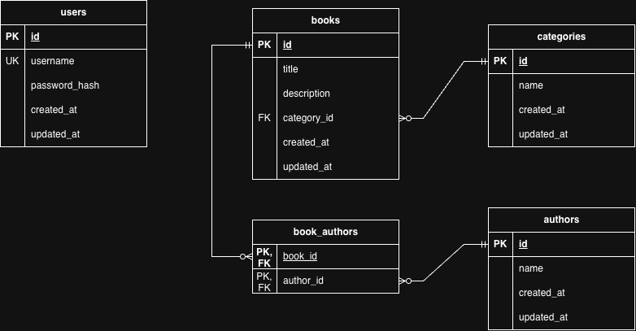

# Personal Book Library

เว็บแอปพลิเคชันสำหรับดูรายชื่อหนังสือ เพิ่ม ค้นหา (กรอง) และลบหนังสือ โดยหนังสือแต่ละเล่มมีความสัมพันธ์กับผู้แต่ง (Author) และหมวดหมู่ (Category) พร้อมระบบยืนยันตัวตนด้วย JWT

## Link Website
[\[!link\]personal-book-library-psi.vercel.app](https://personal-book-library-psi.vercel.app)

## Tech Stack

- Backend: NestJS, Node.js, TypeORM
- Frontend: React, vite, TypeScript, Axios, React Router
- Database: PostgreSQL
- Authentication: JWT (passport-jwt), bcrypt
- Deployment: Docker, Docker compose

## Run backend and database

```bash
# เชื่อมไฟล์ backend
cd backend

# ติดตั้ง package
pnpm install

# รัน backend
pnpm start:dev
```

```bash
# สร้างไฟล์ migate
pnpm run migration:generate

# รัน migate 
pnpm run migration:run

# ย้อนกลับ migate ล่าสุด
pnpm run migration:revert
```
Backend จะรันที่ http://localhost:3001 และแสดงข้อความ `Book library server is up and ready to roll` เมื่อพร้อมใช้งาน

## Run Frontend

```bash
# เชื่อมไฟล์ frontend
cd frontend

# ติดตั้ง package
pnpm install

# รัน frontend
pnpm dev
```

เปิด http://localhost:5173

## Run Docker

```bash
# รัน และ build
docker compose up --build -d

# เช็ค container
docker compose ps 

# หยุดการรันและ ลบ volum ออก
docker compose down -v
```

## Backend environment

```env
# ประกาศตัวแปรสำหรับเชื่อมต่อ database postgreSQL
DB_HOST=localhost
DB_PORT=5432
DB_USERNAME=postgres
DB_PASSWORD=nuntawat838
DB_DATABASE=book_library

# คีย์ซีเคร็ท และระยะเวลาหมดอายุ
JWT_SECRET=super-ultra-secret-key
JWT_EXPIRES_IN=1h

# ตัวเทส login
SEED_ADMIN_USERNAME=admin
SEED_ADMIN_PASSWORD=123456
```

## Frontend environment

```env
# เรียกใช้ API จาก URL ที่รันอยู่ใน backend
VITE_API_URL=http://localhost:3001/api
```

## ข้อมูลตั้งต้น (Category / Author)

โจทย์ไม่มี endpoint สำหรับสร้างหมวดหมู่และผู้แต่ง ต้องใส่ข้อมูลผ่าน SQL ก่อนสร้างหนังสือ

```sql
INSERT INTO categorys (name) VALUES
  ('Programming'),
  ('Mindset'),
  ('Complete Science');

INSERT INTO authors (name) VALUES
  ('Robert'),
  ('J.K. Rowling'),
  ('Morgan');
```

## API Endpoints

- `POST /api/login` รับ username/password ส่งกลับ JWT
- `GET /api/books` แสดงรายการหนังสือ กรองได้ด้วย `?categoryId=` และ `?authorId=`
- `GET /api/books/:id` แสดงหนังสือเล่มเดียว ถ้าไม่พบจะแจ้ง 404
- `POST /api/books` (ใช้ Accesstoken จากการ login) เพื่อสร้างหนังสือ สำเร็จจะแจ้ง 201
- `DELETE /api/books/:id` (ใช้ Accesstoken จากการ login) ลบหนังสือ สำเร็จ 204 ไม่พบ 404
- `GET /api/authors` รายชื่อผู้แต่ง
- `GET /api/categories` รายชื่อหมวดหมู่

## ตัวอย่างเรียกใช้งาน

ตัวอย่างทั้งหมดใช้ `curl` สำหรับความสะดวกของกรรมการ

### 1) Login (POST /api/login)

```bash
curl -X POST http://localhost:3001/api/login \
  -H "Content-Type: application/json" \
  -d '{"username":"admin","password":"123456"}'
```

ทำการเก็บ Accesstoken

### 2) ดูรายการหนังสือทั้งหมด (GET /api/books) ไม่ต้อง login

```bash
curl http://localhost:3001/api/books
```

### 3) กรองรายการหนังสือ (GET /api/books?categoryId=&authorId=)

```bash
# กรองตามหมวดหมู่
curl "http://localhost:3001/api/books?categoryId=1"

# กรองตามผู้แต่ง
curl "http://localhost:3001/api/books?authorId=1"

# กรองทั้งสองอย่างพร้อมกัน
curl "http://localhost:3001/api/books?categoryId=1&authorId=1"
```

### 4) ดูหนังสือเล่มเดียว (GET /api/books/:id)

```bash
curl http://localhost:3001/api/books/1
```

### 5) สร้างหนังสือ (POST /api/books) ต้อง login

```bash
curl -X POST http://localhost:3001/api/books \
  -H "Authorization: Bearer $TOKEN" \
  -H "Content-Type: application/json" \
  -d '{"title":"Test","description":"sixseven","category_id":1,"author_ids":[1]}'
```

### 6) ลบหนังสือ (DELETE /api/books/:id) ต้อง login

```bash
curl -X DELETE http://localhost:3001/api/books/1 \
  -H "Authorization: Bearer $TOKEN" -i
```

### 7) รายชื่อผู้แต่งและหมวดหมู่ (ใช้ทำ dropdown) ไม่ต้อง login

```bash
curl http://localhost:3001/api/authors
curl http://localhost:3001/api/categories
```

## ER Diagram



ความสัมพันธ์:

- `categories` 1 — N `books`
- `books` N — N `authors` (ผ่านตาราง book_authors)
- `users` ใช้สำหรับ login อย่างเดียว ไม่มีความสัมพันธ์กับตารางอื่น